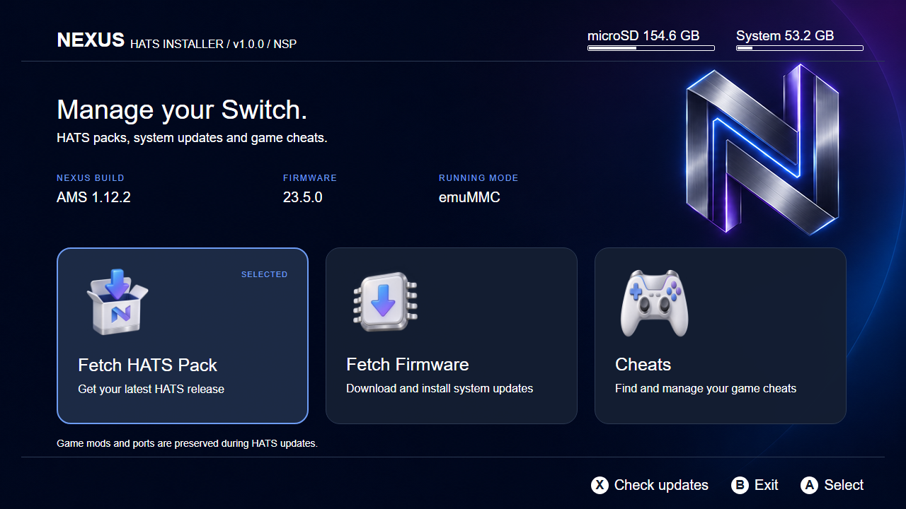

# Nexus HATS Installer

Download and install the latest Nexus HATS packs directly on your Switch.

[Download the NSP](https://github.com/TR4UNEXUS/Nexus-HATS-Installer/releases/latest) · [Nexus HATS packs](https://github.com/TR4UNEXUS/Nexus-USB-HATS/releases) · [Report a problem](https://github.com/TR4UNEXUS/Nexus-HATS-Installer/issues)

*Layout preview using the included artwork. Storage and firmware numbers shown are examples.*

## What it does

- **Fetch HATS Pack** — choose from the packs in the latest Nexus USB HATS release, download one and review the install options.
- **Fetch Firmware** — download system firmware or install it from a local folder.
- **Cheats** — find and manage game cheats.

The familiar three-card layout now uses the Nexus logo, a blue-purple theme,
white text and matching icons. Controller and touch navigation are retained.

Pack names and versions are not fixed in the app. New ZIP variants added to the
release GitHub marks as Latest appear when you reopen the pack list or press X
to refresh. Drafts, prereleases and known non-pack attachments are excluded.

## What's new in 1.0.3

- The Nexus-themed HOC pack now applies the EMU and SYS CFW Launch icons after
  installation, instead of restoring the old red gear settings.
- Existing autoboot settings, boot commands, stock entries and unrelated
  payload icons are retained. Failed or cancelled installs restore the original
  settings; the recovery copy is kept until the restored file is verified.
- Compact pack names, accurate app-update prompts and USB game-map protection
  from the previous releases remain included.

## Install

1. Download the current `Nexus-HATS-Installer-<version>.nsp` from [Releases](https://github.com/TR4UNEXUS/Nexus-HATS-Installer/releases/latest).
2. Install it using your usual homebrew NSP installer.
3. Open **Nexus HATS Installer** from HOME and choose **Fetch HATS Pack**.

The NSP contains the full app, icons, wallpaper and installer payload. A separate
NRO is not needed. For hbmenu, extract the release ZIP onto the SD card and keep
its included support files together. See the [build instructions](switch/README.md)
to build either edition yourself.

Version 1.0.3 has passed compilation and automated checks. Switch testing
and feedback are welcome, particularly for downloads, installation and reboot.

## Existing games and settings

The original backup and installation options are retained. Existing game mods,
unrecognised homebrew and port data are protected during HATS updates. Nexus USB
library indexes and Nexus Manager settings are protected as well.

Version 1.0.1 also protects USB HOME badge data and adjacent repair/recovery
journals and snapshots. All four installation modes keep these files, even
with an empty online exclusion list. Incoming packs cannot replace them or
import another card's USB mappings onto a fresh card. HOC and other managed
sysmodules remain updateable.

Nexus HATS Installer has its own application ID (`01004E5848490000`) and uses
`switch/nexus-hats-installer` and `config/nexus-hats-installer`.

A file-preservation list is included. If `hats-exclusions.json` is added to the
Nexus USB HATS repository's main branch, the installer reads that live list.
A missing list uses the bundled copy; connection or validation failures stop
installation before changing the boot setup.

## Updates

HATS packs come from [TR4UNEXUS/Nexus-USB-HATS](https://github.com/TR4UNEXUS/Nexus-USB-HATS).
Updates to the installer itself come from **this repository**. Both editions
check for an update on launch; X checks manually. Only a newer version prompts
for installation. Installer assets use names such as
`Nexus-HATS-Installer-1.0.3.nsp` or `Nexus-HATS-Installer-1.0.3.zip`.

## Building and contributing

See [Switch build instructions](switch/README.md), [NSP packaging](switch/BUILD_NSP.md)
and [regression checks](switch/tests/README.md).

Help with building, testing and improving Nexus is welcome. If you report a
problem, include your console model, firmware version, the pack you chose and
what happened. Pull requests for fixes, clearer navigation and better
compatibility are welcome too.

## Credits and licence

Adapted from [MM HATS Installer by TechRepairs4U](https://github.com/TechRepairs4U/MM-HATS-INSTALLER),
commit `832e579289ae91e57ed0b1123aaed47ebeead7a3`, retaining its layout and installer workflow.
The original project and bundled libraries retain their copyright notices and licences.
This repository is distributed under [GPL-3.0](LICENSE).
